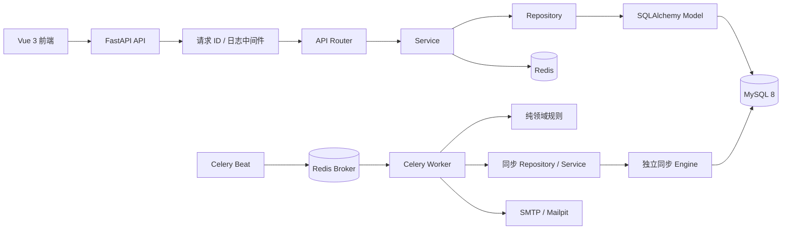

# TicketFlow 后端架构与执行边界

> 更新时间：2026-11-17 14:30（Asia/Shanghai）  
> 对应任务：`A-09`  
> 状态：设计基线；本文中的数据库、业务和 Celery 模块尚未全部实现

## 1. 目标与约束

本文固定 TicketFlow 后端的模块职责、依赖方向、请求链路和数据库会话边界，避免后续功能开发时出现以下问题：

- 路由直接拼 SQL、判断状态机或提交事务。
- FastAPI 的 `AsyncSession` 被 Celery 任务复用。
- 同一个数据库连接池跨线程或跨事件循环共享。
- ORM 对象直接作为 API 响应，导致敏感字段泄露。
- 多个模块分别提交事务，产生部分成功的数据。
- Celery 任务导入 ASGI 依赖、请求对象或 FastAPI Session。

核心原则：

1. API 只负责 HTTP 协议和依赖装配。
2. Service 负责业务用例、权限上下文和事务边界。
3. Repository 只负责数据访问，默认不提交事务。
4. ORM Model 只描述数据库结构。
5. Pydantic Schema 只描述 API 输入输出边界。
6. Infrastructure 封装数据库、Redis、SMTP 等外部设施。
7. 纯领域规则不依赖 FastAPI、SQLAlchemy Session 或 Celery。

## 2. 当前实现与规划边界

### 2.1 已实现

```text
backend/app/
├── main.py                    # FastAPI 应用工厂和模块级 app
├── run.py                     # 本地直接启动入口
├── config.py                  # 类型化环境配置
├── api/
│   ├── router.py              # 聚合路由
│   └── health.py              # /health
└── core/
    ├── errors.py              # 统一错误模型与处理器
    ├── logging.py             # JSON 日志配置
    └── middleware.py          # 请求 ID 和访问日志中间件
```

已具备应用工厂、健康检查、统一错误响应、请求 ID 和脱敏访问日志，但还没有用户、工单、数据库、Celery 或前端业务。

### 2.2 规划模块

```text
backend/app/
├── api/
│   ├── deps/                  # 当前用户、Session、权限等依赖
│   └── routers/               # 按业务拆分 HTTP 路由
├── schemas/                   # Pydantic 请求和响应模型
├── services/                  # 业务用例与事务编排
├── repositories/              # 数据访问
├── models/                    # SQLAlchemy ORM
├── domain/                    # 纯业务规则、枚举和状态机
├── infrastructure/
│   ├── database.py            # 异步 Engine 与 AsyncSession
│   ├── sync_database.py       # Celery 独立同步 Engine 与 Session
│   ├── redis.py               # Redis 客户端
│   └── mail.py                # SMTP 适配器
├── tasks/                     # Celery 任务
└── core/                      # 配置、安全、错误、日志
```

模块名称表达职责边界，具体文件可以在实现时细化，但不得把相同职责重新塞回路由或任务函数。

## 3. 总体运行架构



MySQL 是业务状态和最终一致性的事实来源。Redis 只用于缓存、限流、Celery Broker 和任务协同，不能成为工单状态的唯一持久化位置。

## 4. 模块职责

### 4.1 API 层

位置：`backend/app/api/`。

职责：

- 声明 URL、HTTP 方法、状态码和路由标签。
- 通过 FastAPI 依赖取得当前用户、角色和请求级数据库 Session。
- 使用 Pydantic Schema 校验请求、约束响应。
- 调用 Service，不直接写核心 SQL 或状态转换。
- 将业务异常交给统一异常处理器。
- 保持接口函数简短，便于 OpenAPI 和集成测试。

禁止：

- 在路由中 `commit()`、`rollback()` 或拼接复杂查询。
- 直接返回 ORM 实例。
- 用前端按钮或角色菜单替代后端权限检查。
- 在路由之间复制状态机规则。

### 4.2 Service 层

位置：`backend/app/services/`。

职责：

- 实现一个完整业务用例，例如“领取工单”“确认关闭”“创建工单”。
- 组合权限上下文、Repository、领域规则和通知语义。
- 负责写操作的事务边界。
- 在失败时保证业务记录、状态历史和审计记录整体回滚。
- 协调幂等记录、工单和审计等需要原子提交的数据。
- 生成 Python 内部事件或待执行动作，但不在业务事务内阻塞等待邮件。

事务约定：

- Repository 不主动 `commit()`。
- Service 的写操作用例是默认事务所有者。
- Service 成功时提交一次，异常时回滚并重新抛出可识别错误。
- 路由不得在 Service 返回后再提交第二个业务事务。
- 需要跨多个 Repository 的操作必须在同一个 Session 和一个事务中完成。

### 4.3 Repository 层

位置：`backend/app/repositories/`。

职责：

- 封装 SQLAlchemy 查询、分页、排序和条件更新。
- 把“查询某个用户未删除工单”等数据访问语义集中在可测试函数中。
- 提供并发安全的条件更新，例如按 `id + status + assignee IS NULL` 领取。
- 提供显式预加载，避免 N+1 查询。

禁止：

- 决定用户是否有权限。
- 决定状态机是否合法。
- 自己提交业务事务。
- 返回未经权限过滤的数据给 API 层。

Repository 可以接收 Session，但不拥有 Session 的生命周期，也不决定请求或任务的启动方式。

### 4.4 Model 层

位置：`backend/app/models/`。

职责：

- 定义表名、字段、主键、外键、索引、唯一约束和关系。
- 保存持久化字段，如状态、处理人、时间、`token_version` 和软删除标记。
- 通过 Alembic 管理结构变更。

禁止：

- 直接包含 HTTP 状态码、JWT 解析或 Celery 调用。
- 依赖 FastAPI 请求对象。
- 在 ORM 事件中隐式发送邮件或写外部系统。

异步 API 和同步 Celery 可以共享同一套 ORM Model，但不得共享 Session、Engine 连接池或事务。

### 4.5 Schema 层

位置：`backend/app/schemas/`。

职责：

- 定义创建、更新、列表、详情和动作接口的输入输出。
- 使用 Pydantic v2 做字段类型、长度和组合校验。
- 明确哪些字段对外可见。
- 统一分页和时间格式。

约束：

- 创建、列表、详情和更新使用独立 Schema。
- 响应不包含密码哈希、JWT 密钥、数据库连接串或内部堆栈。
- 内部备注 Schema 只能用于有权限的技术人员和管理员接口。

### 4.6 Domain 层

位置：`backend/app/domain/`。

职责：

- 保存工单状态、动作、角色和优先级枚举。
- 实现与数据库无关的状态流转判断。
- 实现 SLA 目标时间、首次响应和解决时间的纯计算。
- 为 API Service 和 Celery Task 提供同一套业务规则。

Domain 层不导入 FastAPI、SQLAlchemy Session、Redis 客户端或 Celery 应用，便于做快速单元测试。

### 4.7 Infrastructure 层

位置：`backend/app/infrastructure/`。

职责：

- 根据配置创建数据库 Engine、Session 工厂和 Redis 客户端。
- 封装 SMTP 邮件发送适配器。
- 提供外部设施的生命周期管理。
- 把第三方库异常转换成应用可识别的异常，避免业务层依赖具体库。

数据库模块必须提供两套独立设施：

| 设施 | 使用者 | 类型 | 生命周期 |
| --- | --- | --- | --- |
| 异步 Engine / `AsyncSession` | FastAPI | `sqlalchemy.ext.asyncio` | 每个请求创建和关闭 |
| 同步 Engine / `Session` | Celery、迁移、Seed | `sqlalchemy.orm` | 每个任务或短生命周期进程创建和关闭 |

两种 Session 可以共享 ORM Model、配置和测试规则，但不能共享实例、连接池或事务。

### 4.8 Core 层

位置：`backend/app/core/`。

职责：

- 统一异常与错误响应。
- 请求 ID、访问日志和敏感字段过滤。
- JWT、密码哈希和认证依赖的公共安全能力。
- 应用配置加载和环境校验。

Core 不应实现具体工单用例。与业务角色、工单状态和 SLA 相关的规则放在 Domain 或 Service。

### 4.9 Tasks 层

位置：`backend/app/tasks/`。

职责：

- 定义 Celery 任务入口。
- 每个任务自行获取同步 Session，并在 `finally` 中关闭。
- 调用可重试、幂等的同步业务函数。
- 将数据库提交和外部邮件发送分开处理。
- 数据库事务成功后再尝试发送邮件；邮件失败不应回滚已经成功的业务状态。

禁止：

- 导入 FastAPI `Request`、认证依赖或路由模块。
- 导入异步数据库 Session 或异步 Session 工厂。
- 把 `AsyncSession` 通过全局变量传给 Celery。
- 在数据库事务尚未提交时发送成功通知。

## 5. 依赖方向

允许的主要依赖方向：

```text
API -> Schema + Service + Core 依赖
Service -> Domain + Repository + Schema（按需）
Repository -> Model + SQLAlchemy
Model -> SQLAlchemy
Task -> Sync Service/Repository + Domain + Infrastructure 同步设施
Infrastructure -> 配置 + 第三方库
Domain -> Python 标准库 / 纯业务类型
```

禁止的依赖：

```text
Model -> API / Task
Repository -> API / Task
Domain -> FastAPI / Celery / AsyncSession
Task -> API / FastAPI 认证依赖 / AsyncSession
API -> 直接 SQLAlchemy 复杂查询
Schema -> ORM 查询或外部服务调用
```

业务规则应该向内依赖，外部协议和框架位于外层。这样才能在 API 和 Celery 之间复用规则，同时保持执行方式隔离。

## 6. FastAPI 数据库边界

### 6.1 Engine

FastAPI 使用异步驱动连接 MySQL，例如：

```text
mysql+asyncmy://...
```

应用启动时建立一个共享 `AsyncEngine`，它属于进程级基础设施。请求不得创建新的 Engine。

### 6.2 Session

每个 HTTP 请求通过依赖获得独立 `AsyncSession`：

1. 请求开始创建 Session。
2. 路由、Service 和 Repository 在同一请求内使用该 Session。
3. 成功写操作由 Service 提交。
4. 异常时回滚。
5. 请求结束后关闭 Session。

约束：

- 不把 `AsyncSession` 保存到模块全局变量。
- 不在多个并发请求间共享 Session。
- 不把异步 Session 传给 Celery 或线程池。
- 流式响应不能使用已经关闭的 Session。

### 6.3 请求链路

```text
HTTP Request
  -> 请求 ID / 日志中间件
  -> 认证与权限依赖
  -> Pydantic 输入校验
  -> API 路由
  -> Service 业务用例
  -> Repository 数据访问
  -> MySQL
  -> Pydantic 响应
  -> 统一错误处理或成功响应
  -> 请求日志
```

请求 ID 与访问日志由现有中间件负责。统一错误响应由现有异常处理器负责。

## 7. Celery 同步数据库边界

Celery Worker 不使用 ASGI 生命周期，也不执行 `async with` 请求依赖。

每个任务按以下模式管理同步 Session：

```text
Task 开始
  -> 从独立 sessionmaker 创建 Session
  -> 查询和处理业务
  -> Service 提交事务
  -> 关闭 Session
  -> 数据库提交后再发送邮件
```

关键规则：

- Worker 启动时建立一个独立同步 Engine。
- 每个任务或工作单元创建独立 `Session`，不能跨任务复用一个 Session。
- 任务异常时完成回滚并关闭连接。
- 同步 Engine 不使用 `asyncmy`，应使用同步驱动，例如 `pymysql`。
- Alembic 和 Seed 同样使用自己的短生命周期同步 Session，不复用 Worker 当前任务 Session。
- Celery 重试必须依赖数据库幂等约束或事件唯一键，不能依赖进程内布尔变量。

## 8. 事务与一致性边界

### 8.1 原子写入

以下操作必须在同一事务内完成：

- 工单状态变化 + 处理人变化 + 状态历史。
- 工单创建 + 幂等记录。
- 工单关键操作 + 审计记录。
- 通知业务事件创建 + 对应业务状态提交。
- SLA 事件唯一键插入 + 站内通知创建。

### 8.2 不放入数据库事务的操作

以下外部动作不应长时间占用数据库事务：

- SMTP 网络请求。
- Redis 非关键缓存刷新。
- Celery 远程投递。

推荐先提交数据库结果，再执行外部动作。外部动作失败后由持久化事件、重试或后续补偿处理；P2 Outbox 若未实现，README 必须明确异步通知可能延迟或丢失。

### 8.3 并发控制

- 领取工单使用条件更新或 MySQL 行锁。
- 幂等创建使用数据库唯一约束。
- SLA 扫描事件使用数据库唯一约束去重。
- API 和 Celery 的最终并发验收必须连接真实 MySQL 8，SQLite 结果不能作为最终证据。

## 9. 认证与数据可见边界

- API 默认要求认证，只有健康检查、登录等明确公开接口例外。
- 每次认证都加载当前用户，检查启用状态和令牌版本。
- 多角色权限取并集。
- 员工、技术人员和管理员的数据范围由 Service 和 Repository 共同保证：认证依赖提供身份，Service 决定允许动作，Repository 强制查询范围。
- 技术人员只能处理当前属于自己的工单。
- 内部备注在 Repository 查询或 Schema 序列化前根据权限剔除。
- 管理员不能代替员工确认正常处理结果。

## 10. 日志、错误与可观测性

- 每个请求生成唯一 `X-Request-ID`。
- 访问日志只输出方法、路径、状态码、耗时和请求 ID。
- 查询串、认证头、密码、JWT、请求体和响应体不进入访问日志。
- 业务异常使用统一结构：`error.code`、`error.message`、`error.details`。
- 数据库错误和第三方异常不能把 SQL、堆栈或敏感配置返回给客户端。
- 数据库审计日志与运行访问日志用途不同：审计日志是可查询的持久业务数据，访问日志用于运行排查。

## 11. 测试边界

| 测试类型 | 数据库/设施 | 验证重点 |
| --- | --- | --- |
| Domain 单元测试 | 无数据库 | 状态机、SLA 时间计算、角色判断 |
| API 集成测试 | 真实 MySQL 测试库 + 异步 Session | 认证、权限、Schema、错误响应、事务 |
| Repository 测试 | 真实 MySQL 测试库 | 查询范围、分页、索引和条件更新 |
| Celery 任务测试 | 独立同步测试 Session + 假邮件适配器 | 重试、提交后发送、任务去重 |
| 并发测试 | 独立真实 MySQL 8 | 条件更新、唯一约束、事务竞争 |
| 浏览器端到端测试 | Compose 全链路 | 三角色主流程和真实 API 数据 |

测试不能只验证“函数可以调用”。完成标准必须包括数据库最终状态、HTTP 响应、日志证据或邮件结果。

## 12. 已冻结的设计决策

以下规则后续实现不得随意改变：

1. FastAPI 使用异步 Session；Celery 使用独立同步 Session。
2. 异步和同步设施不共享连接池、Session 或事务。
3. Repository 不拥有 Session 生命周期，不主动提交业务事务。
4. Service 是默认事务所有者，路由不提交事务。
5. 业务状态以 MySQL 为最终事实来源。
6. API 不直接返回 ORM 对象。
7. Celery 任务不导入 ASGI/API 模块。
8. 状态机与 SLA 纯规则从执行环境中解耦。
9. 登录、创建工单和评论在后续阶段接入限流。
10. 并发、唯一约束和幂等的最终证据必须来自真实 MySQL 8。

## 13. 后续文档关系

- `A-10`：基于本文定义概念数据关系图。
- `A-11`：在本文模块边界上定义状态流转矩阵。
- `A-12`：固定 API 路径、分页、时间、认证头和幂等头约定。
- `B-05` 至 `B-10`：把本文的异步/同步数据库边界落成代码与真实 MySQL 测试设施。
- `J-13`：在最终交付前补充实际实现、事务时序和异步链路图。
