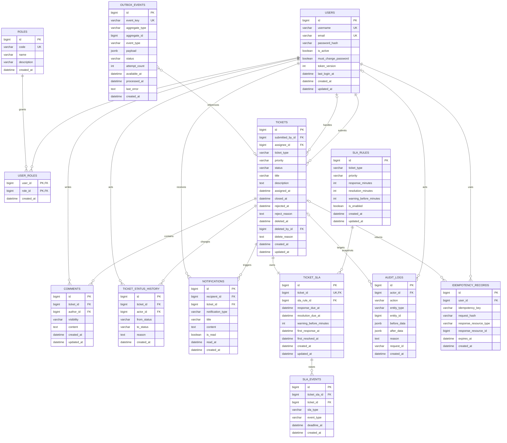

# TicketFlow 概念数据关系

> 更新时间：2026-11-17 14:38（Asia/Shanghai）  
> 对应任务：`A-10`  
> 架构基线：[architecture.md](architecture.md)  
> 状态：概念模型；尚未创建 ORM、迁移或物理数据库表

## 1. 文档目标

本文定义 TicketFlow 第一版核心实体、关系、数据所有权和关键唯一约束，用于指导后续 ORM 模型、Alembic 迁移、Repository 查询和测试设计。

本文不是最终物理表结构：

- 字段类型采用概念级类型，实际 MySQL 类型在模型和迁移任务中确定。
- 字段名可小幅调整，但实体关系和唯一约束不能在实现时无意丢失。
- 状态流转矩阵由 `A-11` 单独定义，本文只列出状态枚举，不描述动作合法性。
- 附件、WebSocket、自动派单、多租户和组织层级不进入本模型。

统一约定：

1. 业务主键使用稳定的数值 ID，具体 `BIGINT` 或其它类型由模型任务确定。
2. 数据库时间统一按 UTC 存储，API 再按约定格式输出。
3. 用户名和邮箱全局唯一。
4. 用户停用不删除账号，保留历史工单和审计关系。
5. 工单异常数据采用软删除，普通查询排除，审计仍可追溯。
6. 审计、幂等和 Outbox 不能通过普通业务 API 修改。

## 2. 概念 ER 图

`OUTBOX_EVENTS` 属于可延后的 P2 能力；若本轮不实现，后续文档必须明确 Redis 中断时通知可能延迟或丢失。

## 3. 核心实体

| 实体 | 数据所有权与作用 | 关键规则 |
| --- | --- | --- |
| `USERS` | 账号、密码哈希、启用状态、首次改密和 JWT 版本 | 用户名、邮箱唯一；不存明文密码 |
| `ROLES` | 稳定的员工、技术人员、管理员角色定义 | `code` 唯一，不使用散落字符串 |
| `USER_ROLES` | 用户与角色多对多关系 | 同一用户与角色只关联一次；员工默认基础角色 |
| `TICKETS` | 工单主记录、状态、提交人、处理人和软删除 | 提交人必填；处理人可为空；MySQL 是最终事实来源 |
| `COMMENTS` | 员工可见回复和内部处理备注 | 可见级别必填；员工不能读取内部备注 |
| `TICKET_STATUS_HISTORY` | 工单每次状态变化的不可变历史 | 记录原状态、新状态、操作人、原因和时间 |
| `NOTIFICATIONS` | 面向单个用户的站内通知 | 只能由接收人查看和标记已读 |
| `SLA_RULES` | 按工单类型和优先级配置响应、解决和预警时限 | 同一类型与优先级只允许一条有效规则 |
| `TICKET_SLA` | 建单时固化的 SLA 目标和首次达成时间 | 每张工单一条；后续规则修改不追溯 |
| `SLA_EVENTS` | 即将超时和已超时的持久事件 | 数据库唯一键阻止重复提醒 |
| `AUDIT_LOGS` | 关键业务操作的持久审计 | 只追加，普通业务 API 不能修改或删除 |
| `IDEMPOTENCY_RECORDS` | 工单创建重试的请求与响应引用 | 同一用户、同一幂等键最多一条 |
| `OUTBOX_EVENTS` | 数据库事务与外部异步投递之间的可靠事件记录 | P2；`event_key` 唯一，失败可重试 |

## 4. 关系说明

| 关系 | 基数 | 说明 |
| --- | --- | --- |
| 用户—角色 | 多对多 | 通过 `USER_ROLES`；权限取所有角色并集 |
| 用户—提交工单 | 一对多 | `submitted_by_id` 必填 |
| 用户—处理工单 | 一对多 | `assignee_id` 可空；同一工单最多一个当前处理人 |
| 工单—评论 | 一对多 | 评论区分公开回复和内部备注 |
| 工单—状态历史 | 一对多 | 每次变化新增记录，不覆盖旧记录 |
| 用户—通知 | 一对多 | 通知只对一个接收人可见 |
| 工单—通知 | 一对多 | 关联触发通知的业务对象 |
| SLA 规则—SLA 快照 | 一对多 | 一条规则可用于多张工单 |
| 工单—SLA 快照 | 一对一 | 每张工单保存独立截止时间，不随规则修改 |
| SLA 快照—SLA 事件 | 一对多 | 分别记录预警和超时等事件 |
| 用户/工单—审计 | 一对多 | actor 可空用于系统任务；相关工单可空 |
| 用户—幂等记录 | 一对多 | 用户可有多个不同的幂等键 |
| 幂等记录—工单 | 可选多对一 | 重放时返回原工单引用 |
| Outbox—工单 | 可选多对一 | 聚合类型和 ID 描述事件来源 |

## 5. 枚举建议

### 5.1 角色代码

- `employee`：员工。
- `technician`：技术支持人员。
- `admin`：管理员。

### 5.2 工单类型

- `fault`：故障报修。
- `software`：软件申请。
- `permission`：权限申请。

### 5.3 工单状态

- `pending_acceptance`：待受理。
- `assigned`：已分配。
- `in_progress`：处理中。
- `pending_confirmation`：待确认。
- `closed`：已关闭。
- `cancelled`：已取消。
- `rejected`：已拒绝。

状态之间的动作、允许角色和目标状态由 `A-11` 定义。

### 5.4 优先级

- `low`
- `medium`
- `high`
- `urgent`

是否把 `urgent` 纳入 MVP 可在实现前确认；无论最终数量如何，数据库、Schema 和统计必须使用同一套枚举。

### 5.5 评论可见级别

- `public`：员工、当前处理人、管理员可见。
- `internal`：仅当前处理人和管理员可见。

### 5.6 SLA 类型与事件

- SLA 类型：`response`、`resolution`。
- 事件类型：`warning`、`breached`。

### 5.7 Outbox 状态

- `pending`
- `processing`
- `processed`
- `failed`

Outbox 状态只在实现 P2 时启用。

## 6. 关键约束与索引方向

### 6.1 唯一约束

| 约束 | 目的 |
| --- | --- |
| `USERS.username` | 防止重复用户名 |
| `USERS.email` | 防止重复邮箱 |
| `ROLES.code` | 稳定引用角色 |
| `USER_ROLES(user_id, role_id)` | 防止重复授权 |
| `SLA_RULES(ticket_type, priority)` | 防止同一组合的多条冲突规则 |
| `TICKET_SLA.ticket_id` | 保证每张工单只有一个 SLA 快照 |
| `SLA_EVENTS(ticket_id, sla_type, event_type, deadline_at)` | 并发扫描只生成一条事件 |
| `IDEMPOTENCY_RECORDS(user_id, idempotency_key)` | 同一用户同一键只生成一张工单 |
| `OUTBOX_EVENTS.event_key` | 防止重复异步事件 |

### 6.2 主要查询索引

- 用户：用户名、邮箱、启用状态。
- 工单：状态、提交人、处理人、类型、优先级、创建时间和更新时间。
- 组合查询：`submitted_by_id + deleted_at + created_at`、`assignee_id + status + updated_at`。
- 评论：`ticket_id + created_at`，必要时增加 `visibility`。
- 通知：`recipient_id + is_read + created_at`。
- 状态历史：`ticket_id + created_at`。
- 审计：`ticket_id + created_at`、`actor_id + created_at`、`action + created_at`。
- 幂等：用户与键唯一索引、`expires_at` 清理索引。
- Outbox：`status + available_at` 扫描索引。

最终索引必须结合实际查询计划验证，不能仅凭字段列表声称性能合格。

## 7. 关键业务写入集合

### 7.1 创建工单

同一个数据库事务中：

1. 创建幂等记录。
2. 创建工单。
3. 创建初始状态历史。
4. 写入工单创建审计。
5. 创建 SLA 快照。
6. 若实现 P2 Outbox，写入待发送事件。

任一写入失败时，工单和幂等记录都不能部分存在。

### 7.2 分配、转派与领取

同一个事务中：

1. 使用条件更新或行锁修改当前处理人与状态。
2. 写入状态历史。
3. 写入审计。
4. 创建新处理人通知。

领取必须满足当前工单未分配且状态允许的条件。并发最后由 MySQL 唯一关系和条件更新决定。

### 7.3 公开回复

同一个事务中：

1. 写入评论。
2. 首次公开回复时更新 `TICKET_SLA.first_response_at`，后续回复不覆盖。
3. 写入审计或相关业务事件。

内部备注不更新首次员工可见响应时间。

### 7.4 标记解决

同一个事务中：

1. 状态进入待确认。
2. 首次解决时更新 `TICKET_SLA.first_resolved_at`。
3. 写入状态历史和审计。
4. 创建员工待确认通知。

重新打开后继续沿用原 SLA 快照，不生成新的解决目标。

### 7.5 关闭、取消与拒绝

- 员工确认后记录关闭时间。
- 分配前取消记录取消原因。
- 管理员拒绝记录拒绝时间和原因。
- 三者都写入状态历史和审计。

### 7.6 SLA 扫描

1. 查询未关闭、未取消、未删除工单的 SLA 快照。
2. 计算是否达到预警或超时。
3. 尝试插入带唯一键的 SLA 事件。
4. 只有成功插入事件的事务创建通知并准备邮件。
5. 并发扫描由数据库唯一约束去重，Python 预检查只用于减少无效写入。

## 8. 审计、运行日志与通知的区别

| 类型 | 存储位置 | 用途 | 是否可由业务 API 修改 |
| --- | --- | --- | --- |
| 访问日志 | 标准输出/日志系统 | 请求追踪和运行排错 | 否 |
| 审计日志 | MySQL `AUDIT_LOGS` | 追溯业务操作、操作人、前后值和原因 | 否 |
| 站内通知 | MySQL `NOTIFICATIONS` | 面向用户的业务消息 | 仅本人标记已读 |
| 邮件 | SMTP/Mailpit | 异步外部提醒 | 不保存为审计事实 |

审计与访问日志不能互相替代。访问日志可能轮转或清理，审计日志必须作为业务数据长期保留。

## 9. 数据可见性规则

- 员工只能查询本人提交且未删除的工单。
- 技术人员可以查询待领取池和本人负责的工单。
- 管理员查询范围覆盖全部未删除工单。
- 内部备注在 Repository 查询或 Schema 序列化前过滤，不能先返回前端再隐藏。
- 通知只允许接收人查询和标记已读。
- 审计和统计接口只允许管理员访问。
- 数据库连接串、密码哈希、JWT 和 SMTP 密码不进入任何响应或审计前后值。

## 10. 删除与保留策略

- 用户停用使用 `is_active=false`，不物理删除。
- 角色不随账号停用而删除。
- 工单软删除写 `deleted_at`、操作人和原因；状态历史、评论、审计和 SLA 记录保留。
- 状态历史、审计和 SLA 事件只追加。
- 幂等记录只在超过配置的保留时间后由清理任务删除。
- Outbox 事件在成功投递并超过保留窗口后归档或清理。
- 通知可保留，是否清理由后续容量和数据保留策略决定。

## 11. 待后续任务确定的事项

- `A-11`：状态流转、动作、角色和禁止条件。
- `A-12`：API 路径、分页、时间格式、认证头和幂等头。
- `B-07` 至 `B-08`：模型基类、字段类型、实际索引和迁移。
- `C-02` 至 `C-03`：多角色关联和令牌版本的实际约束。
- `D-01` 至 `D-03`：工单枚举、模型和索引。
- `E-14` 至 `E-17`：状态历史与审计模型落地。
- `F-01` 至 `F-05`：幂等记录、请求摘要和同键重放。
- `G-01`、`G-13` 至 `G-22`：通知、SLA 快照、事件唯一键和并发扫描。
- `G-25`：可选 Outbox。

## 12. 设计结论

本模型固定以下事实：

1. 一个账号可以有多个角色。
2. 一张工单只对应一个当前处理人，处理人可暂时为空。
3. 工单评论和状态历史必须分别持久化。
4. SLA 规则是模板，工单保存独立快照。
5. SLA 提醒依赖数据库唯一事件，不能依赖进程内状态。
6. 工单创建依赖用户级幂等键和数据库唯一约束。
7. 审计是不可由普通业务 API 修改的持久记录。
8. Outbox 是 P2 可选记录，不把 Redis 当作可靠事件最终存储。
