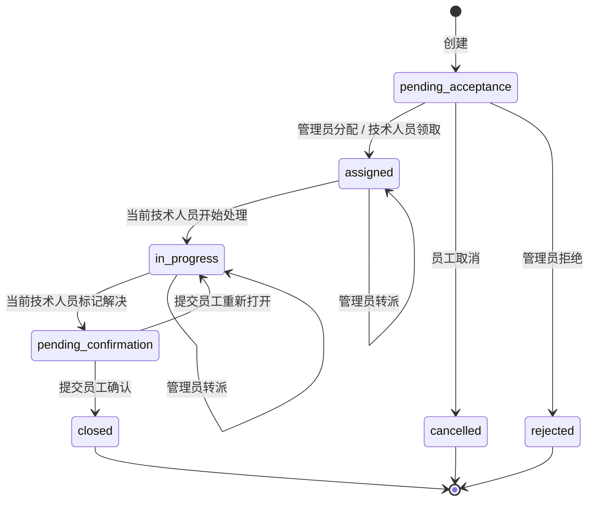

# TicketFlow 工单状态流转矩阵

> 更新时间：2026-11-17 14:42（Asia/Shanghai）  
> 对应任务：`A-11`  
> 架构基线：[architecture.md](architecture.md)  
> 数据模型：[data-model.md](data-model.md)  
> 状态：设计基线；状态机代码尚未实现

## 1. 目的

本文统一定义工单动作的合法性，后续 API、Service、Repository、审计和测试都必须引用同一套规则，不能在路由中重复编写不同的 `if/else`。

本文回答：

- 哪个角色可以执行动作。
- 动作允许从哪个状态出发。
- 动作成功后进入哪个状态。
- 必须满足哪些所有权、处理人和字段条件。
- 哪些状态路径必须被拒绝。
- 动作应产生哪些历史、审计和通知。

状态合法性只回答“业务状态是否允许”；身份、可见范围、必填原因和并发条件仍必须分别校验。

## 2. 状态定义

| 状态代码 | 中文名称 | 是否活动状态 | 说明 |
| --- | --- | --- | --- |
| `pending_acceptance` | 待受理 | 是 | 已提交，尚未分配处理人 |
| `assigned` | 已分配 | 是 | 已有处理人，尚未开始处理 |
| `in_progress` | 处理中 | 是 | 正在处理，或员工重新打开后继续处理 |
| `pending_confirmation` | 待确认 | 是 | 技术人员已标记解决，等待员工确认 |
| `closed` | 已关闭 | 否 | 员工确认解决，正常流程结束 |
| `cancelled` | 已取消 | 否 | 员工在分配前主动撤回 |
| `rejected` | 已拒绝 | 否 | 管理员拒绝不在支持范围内的工单 |

活动状态是 `pending_acceptance`、`assigned`、`in_progress` 和 `pending_confirmation`。终态是 `closed`、`cancelled` 和 `rejected`。

## 3. 状态图

说明：

- 关闭后不能重新打开；需要再次处理时必须创建新工单。
- 取消和拒绝都是终态。
- 转派不改变 `assigned` 或 `in_progress` 状态，但会改变当前处理人并写入审计。
- 软删除是管理员异常数据处理动作，不改变业务状态，不等于取消或拒绝。

## 4. 角色与所有权规则

### 4.1 角色代码

- `employee`：员工。
- `technician`：技术人员。
- `admin`：管理员。

多角色账号的接口能力取角色并集，但涉及“本人提交”或“当前处理人”的动作仍必须校验具体关系。例如管理员同时拥有员工角色时，也只能确认自己提交的工单。

### 4.2 所有权判定

| 概念 | 判定方式 |
| --- | --- |
| 提交员工 | `ticket.submitted_by_id == current_user.id` |
| 当前处理人 | `ticket.assignee_id == current_user.id` |
| 有效技术人员 | 用户已启用，并拥有 `technician` 角色 |
| 可管理工单 | 当前用户拥有 `admin` 角色 |
| 工单可访问 | 未软删除，且满足员工、技术员或管理员的数据范围 |

角色正确但所有权不满足时返回 403。资源对当前用户完全不可见时返回 404，避免泄露其他用户工单是否存在。

## 5. 动作流转矩阵

### 5.1 状态变更动作

| 动作代码 | 动作 | 允许角色 | 原状态 | 目标状态 | 必须满足的条件 | 禁止条件 |
| --- | --- | --- | --- | --- | --- | --- |
| `create` | 创建工单 | 员工、技术人员、管理员（账号须有 `employee` 基础角色） | 无 | `pending_acceptance` | 提交人取当前用户；标题、描述、类型合法；幂等请求合法 | 无员工角色；伪造提交人；重复幂等键对应不同请求 |
| `assign` | 管理员分配 | 管理员 | `pending_acceptance` | `assigned` | 目标是启用且拥有 `technician` 角色的用户；工单当前无处理人 | 非管理员；目标不是有效技术员；工单已分配；工单已删除 |
| `claim` | 技术人员领取 | 技术人员 | `pending_acceptance` | `assigned` | 领取人有效；工单当前无处理人；数据库条件更新成功 | 管理员或员工领取；工单已被他人领取；已分配；已删除 |
| `transfer` | 管理员转派 | 管理员 | `assigned`、`in_progress` | 原状态不变 | 新处理人有效；新处理人不能与原处理人相同 | 非管理员；工单未分配；新旧处理人相同；目标账号停用或非技术员 |
| `start` | 开始处理 | 当前处理人 | `assigned` | `in_progress` | 当前用户是当前处理人 | 非当前处理人；管理员代点开始；状态不是已分配 |
| `resolve` | 标记已解决 | 当前处理人 | `in_progress` | `pending_confirmation` | 当前用户是当前处理人；至少有一次有效处理记录；填写解决说明 | 非当前处理人；管理员代替解决；状态不是处理中；处理说明为空 |
| `confirm_close` | 确认关闭 | 提交员工 | `pending_confirmation` | `closed` | 当前用户是提交员工 | 非提交员工；管理员代替确认；状态不是待确认 |
| `reopen` | 重新打开 | 提交员工 | `pending_confirmation` | `in_progress` | 当前用户是提交员工；填写重新打开原因 | 非提交员工；管理员代替操作；状态不是待确认；原因为空 |
| `cancel` | 主动取消 | 提交员工 | `pending_acceptance` | `cancelled` | 当前用户是提交员工；工单没有处理人 | 非提交员工；已分配；处理中；已进入终态 |
| `reject` | 管理员拒绝 | 管理员 | `pending_acceptance` | `rejected` | 填写拒绝原因；工单没有处理人 | 非管理员；已分配；处理中；待确认；已进入终态 |

### 5.2 保持状态不变的业务动作

| 动作代码 | 动作 | 允许角色 | 允许状态 | 条件与效果 | 禁止条件 |
| --- | --- | --- | --- | --- | --- |
| `edit` | 编辑工单内容 | 提交员工 | `pending_acceptance` | 可修改标题、描述、类型和建议优先级 | 已分配；无提交员工所有权；软删除 |
| `adjust_priority` | 调整优先级 | 管理员 | 所有活动状态 | 必须填写原因，记录前后值和操作人 | 终态；原因为空；软删除工单 |
| `add_public_comment` | 添加员工可见回复 | 提交员工、当前处理人、管理员 | 活动状态 | 按权限对员工可见；当前处理人首次公开回复更新 SLA 首次响应时间 | 终态；越权；内部可见字段被公开 |
| `add_internal_note` | 添加内部备注 | 当前处理人、管理员 | `assigned`、`in_progress`、`pending_confirmation` | 仅当前处理人和管理员可见；不更新员工首次响应时间 | 员工访问；非当前处理人技术人员；终态 |
| `soft_delete` | 软删除异常工单 | 管理员 | 所有状态 | 必须填写原因，写删除人和删除时间，写审计；普通查询排除 | 非管理员；原因为空；物理删除 |

优先级调整是否重算 SLA：

- 工单创建时已经固化 SLA 快照。
- 第一版优先级调整不静默重算既有响应和解决截止时间，避免通过调整优先级绕过超时。
- 调整只写审计和当前优先级；若产品后续要求重算，必须新增明确规则和测试，不能由实现者临时决定。

## 6. 动作的前置条件

所有动作共同要求：

1. 请求已认证，账号已启用。
2. JWT 令牌版本与当前用户一致。
3. 工单存在且未软删除。
4. 当前用户满足角色和具体所有权条件。
5. 工单当前状态在动作允许列表中。
6. 请求 Schema 校验通过。
7. 必填原因、说明或幂等键不为空。

额外业务前置条件：

| 条件 | 使用动作 |
| --- | --- |
| 工单无处理人 | `assign`、`claim`、`cancel`、`reject` |
| 工单已有有效处理人 | `transfer`、`start`、`resolve`、内部备注 |
| 用户是提交员工 | `edit`、`cancel`、`confirm_close`、`reopen` |
| 用户是当前处理人 | `start`、`resolve`、内部备注 |
| 目标是启用技术人员 | `assign`、`transfer` |
| 必填原因 | `reopen`、`reject`、`adjust_priority`、`soft_delete` |
| 条件更新或行锁成功 | `assign`、`claim`、`transfer` |

## 7. 禁止的状态路径

以下路径必须由统一状态机拒绝：

| 禁止路径 | 原因 |
| --- | --- |
| `closed -> in_progress` | 关闭是终态，重新处理必须建新工单 |
| `closed -> closed` | 重复关闭 |
| `cancelled -> *` | 已取消是终态 |
| `rejected -> *` | 已拒绝是终态 |
| `pending_acceptance -> in_progress` | 未分配不能直接开始 |
| `pending_acceptance -> pending_confirmation` | 未处理不能直接解决 |
| `assigned -> pending_confirmation` | 未开始处理不能直接解决 |
| `assigned -> closed` | 未处理不能由员工确认关闭 |
| `in_progress -> closed` | 必须先标记待确认，再由员工关闭 |
| `pending_confirmation -> closed`（非提交员工） | 管理员不能代替员工确认 |
| `pending_confirmation -> in_progress`（无原因） | 重新打开必须写原因 |
| 任意活动的已分配状态 `-> cancelled` | 取消仅允许分配前 |
| 任意状态 `-> rejected`（非待受理） | 拒绝只允许未分配、未开始处理的待受理工单 |

重复执行同一动作通常返回 409。例如重复领取、重复关闭、重复解决和重复取消不能被当作成功。

## 8. 并发规则

### 8.1 分配与领取竞争

同一待受理工单被多个请求同时分配或领取时：

- 只能有一个请求成功把 `assignee_id` 从空设置为有效用户。
- 成功请求的状态进入 `assigned`。
- 其余请求重新读取后返回冲突，不得覆盖成功处理人。
- 最终结果必须由真实 MySQL 8 条件更新或行锁验证。

### 8.2 转派与开始处理竞争

- 转派和当前处理人开始处理不能同时基于旧处理人成功。
- 转派成功后，旧处理人立即失去开始、内部备注和解决权限。
- 动作应基于预期的当前处理人和当前状态执行条件更新。

### 8.3 解决与重新打开

- 解决只允许一个从 `in_progress` 到 `pending_confirmation` 的成功变更。
- 员工确认和重新打开并发时，只能有一个结果成为最终状态。
- 冲突请求不能留下部分状态历史或审计记录。

## 9. 状态历史与审计

### 9.1 状态历史

状态发生变化时，原子写入：

- 原状态。
- 目标状态。
- 操作人。
- 原因或备注。
- 时间。

转派不改变状态时，通过审计记录原处理人、新处理人、操作人和原因；是否额外写状态历史由实现决定，但不能伪造实际状态变化。

### 9.2 审计动作

至少记录以下审计动作：

- `ticket.created`
- `ticket.updated`
- `ticket.assigned`
- `ticket.claimed`
- `ticket.transferred`
- `ticket.started`
- `ticket.resolved`
- `ticket.closed`
- `ticket.reopened`
- `ticket.cancelled`
- `ticket.rejected`
- `ticket.priority_changed`
- `ticket.soft_deleted`

审计必须与对应业务写入处于同一事务。审计失败时，业务动作失败并整体回滚。

## 10. 通知触发

| 动作 | 通知接收人 | 说明 |
| --- | --- | --- |
| 分配或转派 | 新处理人 | 原处理人不再看到待办 |
| 技术员领取 | 领取人及需要知会的管理员 | 按后续通知实现确定管理员范围 |
| 添加公开回复 | 提交员工或当前处理人 | 避免通知操作者自己 |
| 标记解决 | 提交员工 | 提醒待确认 |
| 重新打开 | 当前处理人 | 技术员待办恢复 |
| 确认关闭 | 当前处理人及管理员 | 按通知配置决定具体范围 |
| SLA 预警或超时 | 当前处理人和管理员；未分配时仅管理员 | 由 SLA 扫描单独触发 |

通知失败不能回滚已经提交的业务事务。没有 Outbox 时，必须明确通知可能延迟或丢失。

## 11. HTTP 错误映射

| 场景 | HTTP 状态 | 错误码 |
| --- | --- | --- |
| 未登录或令牌过期 | 401 | `AUTHENTICATION_FAILED` |
| 角色或所有权不满足 | 403 | `AUTHORIZATION_DENIED` |
| 工单不存在或不可见 | 404 | `RESOURCE_NOT_FOUND` |
| 状态不允许、重复动作、并发冲突 | 409 | `BUSINESS_CONFLICT` |
| 必填原因缺失、非法枚举、字段越界 | 422 | `VALIDATION_ERROR` |

错误响应继续使用现有统一结构，不返回 SQL、堆栈或内部状态机实现细节。

## 12. 关键测试矩阵

自动化测试至少覆盖：

- 每个允许动作的成功路径。
- 每个动作在所有禁止状态下的拒绝路径。
- 员工不能查看或操作其他员工工单。
- 技术人员不能处理非本人负责工单。
- 管理员不能代替员工确认关闭或重新打开。
- 并发分配和领取只有一个成功。
- 转派后旧处理人失去处理权限。
- 关闭后不能重新打开。
- 重复领取、重复关闭和重复解决返回冲突。
- 公开回复首次写入响应时间，内部备注不写入响应时间。
- 每个成功状态变化都有状态历史和审计。
- 审计写入失败时业务状态不提交。

最终并发证据必须连接真实 MySQL 8，SQLite 结果不能作为最终验收。

## 13. 后续实现约束

- `E-01` 必须把本矩阵实现为单一状态规则来源。
- `E-02` 必须把状态、处理人、时间和历史写入放入同一事务。
- `E-03` 至 `E-13` 的 API 与 Service 必须引用本矩阵。
- `E-18` 必须覆盖非法流转和越权。
- `E-19` 必须覆盖完整生命周期和重新打开路径。
- 后续新增状态或动作时，必须先更新本文件和状态测试，再改代码。
